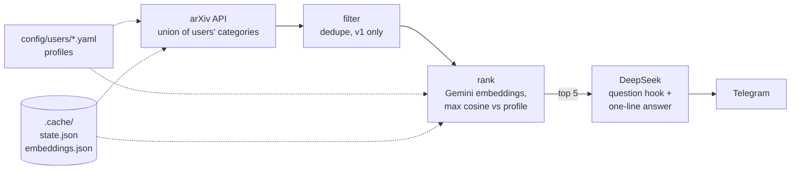
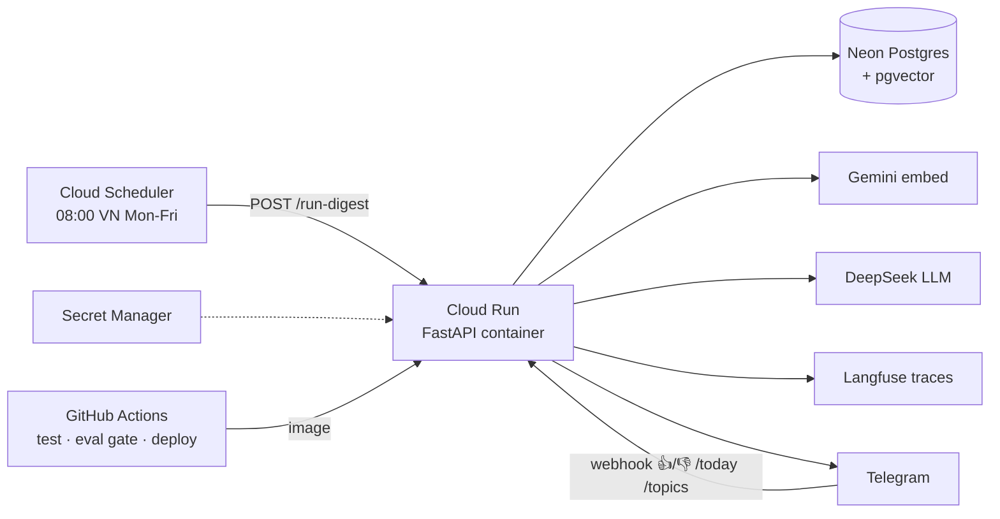

# Newsloader

A daily arXiv digest, ranked against your own interest profile and sent to Telegram.

## Why

arXiv publishes 398 to 591 papers a day in the 5 categories I measured (cs.CL, cs.AI, cs.LG, cs.IR, cs.CV; D6). That is too many to scan.

Keyword filters miss relevant work: one study found about 20% recall (Blair & Maron 1985), and two people pick the same term less than 20% of the time (Furnas et al. 1987; both cited in D2). So ranking uses embeddings compared to a per-user profile. Nothing user-specific lives in code; a profile is one YAML file.

It is also a CV project meant to show deployment, CI eval, tracing and cost control. Those parts are planned, not built yet (see Status).

## What you get

Sample output (real, from `tests/fixtures/arxiv_sample.json`). `format_paper` in `telegram.py` lays out each item as a linked title, a question hook, and a 💡 one-line answer:

```
1. <linked title: Cheap Retrieval and Observation Credit Assignment from One Quantity: The Value of Information>
What single measure could cut memory retrieval costs?
💡 The authors argue one quantity, information value, can guide both memory retrieval and credit assignment.
```

The top 5 papers per user go out in one message (split if over Telegram's 4096 characters). No papers means a "Quiet day" note.

## How it works (built today)



- **Fetch** (`sources.py`): arXiv API, newest first, in pages of 200, 3 s apart, retry on 429/503. Input: the union of every profile's categories and a start time. Output: paper dicts. It resumes from the last published paper in `.cache/state.json`, not "the last 24 hours", because the arXiv API lags by days. First run looks back 72 hours.
- **Filter** (`filters.py`): drops duplicate IDs (cross-lists) and anything not `v1`. No keyword rules, on purpose (D2). Output: kept papers.
- **Rank** (`rank.py`): drops papers with a profile's `blocked_words`, embeds title + abstract with `gemini-embedding-001` (768 dims), scores each paper by its best-matching topic (max cosine), keeps the top 5. Vectors are cached by paper ID in `.cache/embeddings.json`, and new papers are capped at 900 a run for the free tier. Topic texts are embedded again each run. There is no rerank step: it would still need an LLM for the text, so it is added only if the eval shows a clear win (D2).
- **Summarize** (`summarize.py`): DeepSeek `deepseek-v4-flash` returns JSON with an answer and a hook for the top 5 only, capped at 200 output tokens. The prompt asks for the answer first and builds the hook from it, so the question fits the finding. This is a prompt rule, not a check, so quality still varies. Thinking is disabled because reasoning tokens would eat the 200-token cap. A bad reply falls back to the first 200 characters of the abstract.
- **Send** (`telegram.py`): HTML messages via the Bot API with httpx, no framework. It skips `raise_for_status`, whose error text would include the token from the URL.
- **Orchestrate** (`digest.py`): runs the steps per profile. State is saved only after every send worked, so a failed run retries the same papers. It is not saved with `--limit` or `--dry-run`.

## Planned architecture (not built yet)

This is the target from `docs/architecture.md`. None of the cloud parts exist yet.



## Quick start

Needs Python 3.12+ and [uv](https://docs.astral.sh/uv/).

```bash
uv sync
cp .env.example .env     # then fill in the keys below
```

Keys in `.env`: `GEMINI_API_KEY`, `DEEPSEEK_API_KEY`, `TELEGRAM_BOT_TOKEN`, `TELEGRAM_CHAT_ID`. The file is gitignored.

```bash
# try it: 3 papers, print instead of sending
uv run --env-file .env newsloader digest --limit 3 --dry-run

# full run: fetch, rank, summarize, send to Telegram
uv run --env-file .env newsloader digest

# tests (no keys, no network)
uv run pytest
```

Add a user: copy `config/users/matcry.yaml` to `config/users/<name>.yaml`. Set `name`, `categories`, `topics` (each a `name` and a `pseudo_abstract` written in paper vocabulary), optional `blocked_words`, and `chat_env`, the name of the env var that holds that user's chat ID. Add that variable to `.env`. Each user gets their own digest.

## Cost

First real run: 552 papers fetched, 548 kept, 211,222 estimated tokens. Almost all of it is Gemini embeddings, which run on the free tier. Free tier limits (D6): 100 requests/min, 30k tokens/min, 1,000 requests/day, so papers go in batches of 80, with a wait and retry on 429. Token counts are a chars/4 estimate for embeddings and the API's own count for DeepSeek. Cost tracking and caps are planned.

## Status

| Part | Status |
|---|---|
| arXiv fetch | built |
| Filter (dedupe, v1) | built |
| Gemini ranking | built |
| DeepSeek summaries | built |
| Telegram send | built |
| `digest` CLI | built |
| File-based state (`.cache/`) | built |
| Langfuse tracing + cost footer | planned |
| Docker, Cloud Run, Cloud Scheduler, CI deploy | planned |
| Neon Postgres + pgvector | planned |
| Telegram 👍/👎, `/today`, `/topics` | planned |
| Eval gate in CI (golden set, precision@5) | planned |
| Cost guardrails (per-run cap, monthly budget) | planned |

## More

- [docs/architecture.md](docs/architecture.md): the pipeline and the target deployment.
- [docs/decisions.md](docs/decisions.md): design decisions D1 to D14, with the why.
