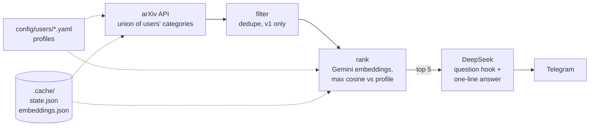
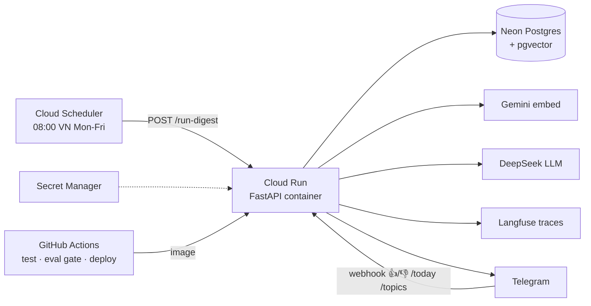

# Newsloader

A daily arXiv digest, ranked against your own interest profile and sent to Telegram.

## At a glance

| | |
|---|---|
| Problem | arXiv posts 398 to 591 papers a day in the 5 categories I measured (cs.CL, cs.AI, cs.LG, cs.IR, cs.CV; D6). Too many to scan. |
| Approach | Gemini embeddings compared to a per-user profile. A profile is one YAML file. |
| Stack | Python 3.12, uv, httpx, `gemini-embedding-001`, `deepseek-v4-flash`, Telegram Bot API |
| Status | Core pipeline built. Cloud deploy, tracing, cost tracking and CI eval are planned, not built. |
| First real run | 552 papers fetched, 548 kept, 211,222 estimated tokens |

## Sample item

Real output, from `tests/fixtures/arxiv_sample.json`. `format_paper` in `telegram.py` lays out each item as a linked title, a question hook, and a 💡 one-line answer.

```
1. <linked title: Cheap Retrieval and Observation Credit Assignment from One Quantity: The Value of Information>
What single measure could cut memory retrieval costs?
💡 The authors argue one quantity, information value, can guide both memory retrieval and credit assignment.
```

The top 5 papers per user go out in one message (split if over Telegram's 4096 characters). No papers means a "Quiet day" note.

## Why embeddings, not keywords

Keyword filters miss relevant work. One study found about 20% recall (Blair & Maron 1985), and two people pick the same term less than 20% of the time (Furnas et al. 1987; both cited in D2). Nothing user-specific lives in code.

This is also a CV project meant to show deployment, CI eval, tracing and cost control. Those parts are planned (see Status).

## How it works



| Step | Module | Input | Output | Key choice |
|---|---|---|---|---|
| Fetch | `sources.py` | All profile categories, start time | Paper dicts | Resumes from last published paper, not "last 24 h" |
| Filter | `filters.py` | Papers | Kept papers | Drops duplicate IDs and non-`v1`. No keyword rules (D2) |
| Rank | `rank.py` | Kept papers, profile | Top 5 | Max cosine over topics, embeddings cached by paper ID |
| Summarize | `summarize.py` | Top 5 | Hook + answer | `deepseek-v4-flash`, 200 output tokens, thinking off |
| Send | `telegram.py` | Digest items | Telegram message | httpx, no framework |
| Orchestrate | `digest.py` | Profiles | One digest per user | State saved only after every send worked |

<details>
<summary>Details per step</summary>

- **Fetch**: arXiv API, newest first, pages of 200, 3 s apart, retry on 429/503. State lives in `.cache/state.json`. The API lags by days, which is why it resumes from the last published paper. First run looks back 72 hours.
- **Rank**: drops papers with a profile's `blocked_words`, embeds title + abstract (768 dims), scores each paper by its best-matching topic, keeps the top 5. New papers are capped at 900 a run for the free tier. Topic texts are embedded again each run. There is no rerank step: it would still need an LLM for the text, so it is added only if the eval shows a clear win (D2).
- **Summarize**: returns JSON with an answer and a hook, top 5 only. The prompt asks for the answer first and builds the hook from it, so the question fits the finding. This is a prompt rule, not a check, so quality still varies. Thinking is disabled because reasoning tokens would eat the 200-token cap. A bad reply falls back to the first 200 characters of the abstract.
- **Send**: HTML messages. It skips `raise_for_status`, whose error text would include the token from the URL.
- **Orchestrate**: a failed run retries the same papers. State is not saved with `--limit` or `--dry-run`.

</details>

## Cost (one run)

| Measure | Value |
|---|---|
| Papers fetched / kept | 552 / 548 |
| Estimated tokens | 211,222 |
| Where | Almost all Gemini embeddings, on the free tier |

Free tier limits (D6): 100 requests/min, 30k tokens/min, 1,000 requests/day, so papers go in batches of 80, with a wait and retry on 429. Token counts are a chars/4 estimate for embeddings and the API's own count for DeepSeek. Ranking quality is not measured yet.

## Status

| Built | Planned |
|---|---|
| arXiv fetch | Langfuse tracing + cost footer |
| Filter (dedupe, v1) | Docker, Cloud Run, Cloud Scheduler, CI deploy |
| Gemini ranking | Neon Postgres + pgvector |
| DeepSeek summaries | Telegram 👍/👎, `/today`, `/topics` |
| Telegram send | Eval gate in CI (golden set, precision@5) |
| `digest` CLI | Cost guardrails (per-run cap, monthly budget) |
| File-based state (`.cache/`) | |

## Planned architecture (not built)

Target from `docs/architecture.md`. None of the cloud parts exist yet.



## Quick start

Needs Python 3.12+ and [uv](https://docs.astral.sh/uv/).

```bash
uv sync
cp .env.example .env     # then fill in the keys below
```

Keys in `.env` (gitignored): `GEMINI_API_KEY`, `DEEPSEEK_API_KEY`, `TELEGRAM_BOT_TOKEN`, `TELEGRAM_CHAT_ID`.

```bash
# try it: 3 papers, print instead of sending
uv run --env-file .env newsloader digest --limit 3 --dry-run

# full run: fetch, rank, summarize, send to Telegram
uv run --env-file .env newsloader digest

# tests (no keys, no network)
uv run pytest
```

Add a user: copy `config/users/matcry.yaml` to `config/users/<name>.yaml`. Set `name`, `categories`, `topics` (each a `name` and a `pseudo_abstract` written in paper vocabulary), optional `blocked_words`, and `chat_env`, the name of the env var that holds that user's chat ID. Add that variable to `.env`. Each user gets their own digest.

## Docs

- [docs/architecture.md](docs/architecture.md): the pipeline and the target deployment.
- [docs/decisions.md](docs/decisions.md): design decisions D1 to D14, with the why.
