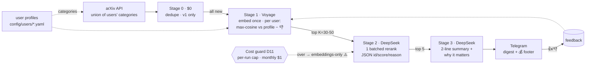
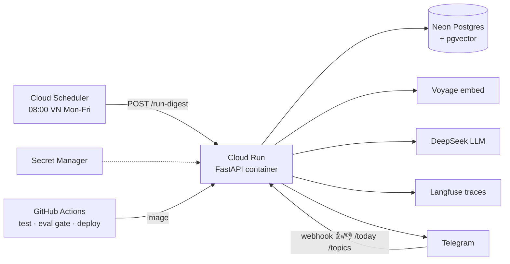

# Architecture — source of truth for the idea (see decisions.md for the why)

## 1. Daily pipeline (D2)

## 2. Runtime & deploy (D4–D9)

## 3. Interfaces (swap points)
| Interface | v1 impl | demo stub | alt later |
|---|---|---|---|
| `Source` | arXiv API | fixture JSON | HN, GitHub trending |
| `Embedder` | Voyage voyage-4-lite | keyword overlap | OpenAI 3-small |
| `LLMClient` | DeepSeek v4-flash | rule-based fake | Haiku |
| `VectorStore` | Neon pgvector | in-memory | Qdrant Cloud |
| `Sender` | Telegram Bot API | print to stdout | — |

## 4. Demo run
Each stage runs alone on `tests/fixtures/arxiv_sample.json` (e.g. `uv run python -m newsloader.stage0`), reviewed, then connected. $0, no keys.
