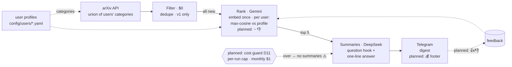
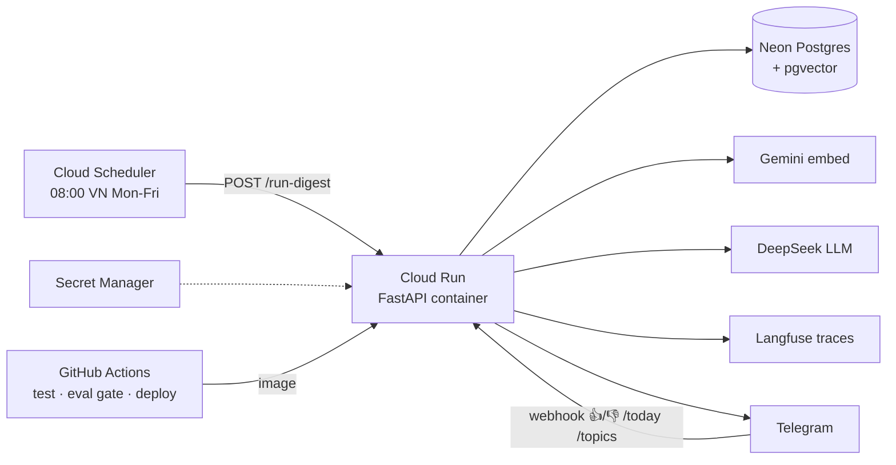

# Architecture — source of truth for the idea (see decisions.md for the why)

Status: section 1 is built except the parts marked planned. Sections 2 and 3 are the target; today it is plain functions run locally.

## 1. Daily pipeline (D2)
Built: arXiv fetch, filter, Gemini rank, DeepSeek summaries, Telegram. Planned: 👎 penalty and feedback loop, 💰 footer, cost guard (D11).

## 2. Runtime & deploy (D4–D9) — planned, not built
Today it runs locally: `newsloader digest`, state in `.cache/` files.

## 3. Interfaces (swap points) — design intent, not code yet
Today these are plain functions, not classes: `fetch_papers` (arXiv only), `embed_gemini` and `chat_deepseek` (passed as `embed` / `chat` callables, so tests inject fakes), `send_message` (Telegram only). No `Source`, `Embedder`, `LLMClient`, `VectorStore` or `Sender` abstraction exists, and there is no vector store: vectors live in `.cache/embeddings.json`. The columns below are the plan.

| Interface | v1 impl | demo stub | alt later |
|---|---|---|---|
| `Source` | arXiv API | fixture JSON | HN, GitHub trending |
| `Embedder` | Gemini gemini-embedding-001 | fake in tests | fastembed local |
| `LLMClient` | DeepSeek v4-flash | rule-based fake | Haiku |
| `VectorStore` | Neon pgvector (planned; today a JSON file) | in-memory | Qdrant Cloud |
| `Sender` | Telegram Bot API | print to stdout | — |

## 4. Demo run
Each module has a `__main__` that runs alone, reviewed, then connected:
- `uv run python -m newsloader.filters`: fixture, $0, no keys.
- `python -m newsloader.sources`: live arXiv fetch (last 24 h, `--hours`), no key.
- `python -m newsloader.rank`: fixture, needs `GEMINI_API_KEY` (run with `uv run --env-file .env`).
- `python -m newsloader.summarize`: fixture, needs `DEEPSEEK_API_KEY`.
- `python -m newsloader.telegram`: fixture, prints messages, no keys; `--send` needs the Telegram vars.
- `newsloader digest --limit 3 --dry-run`: the whole pipeline, needs Gemini and DeepSeek keys.
